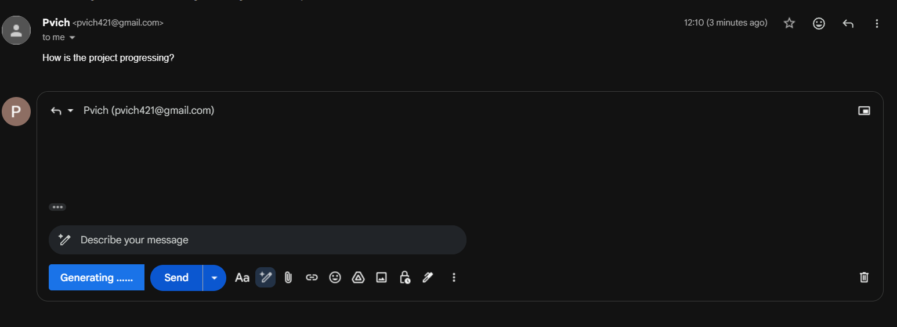
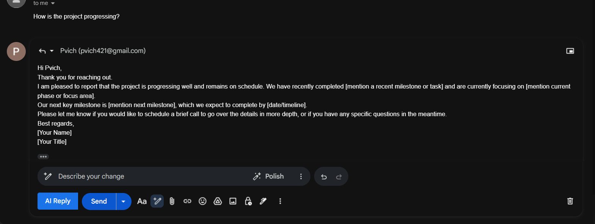
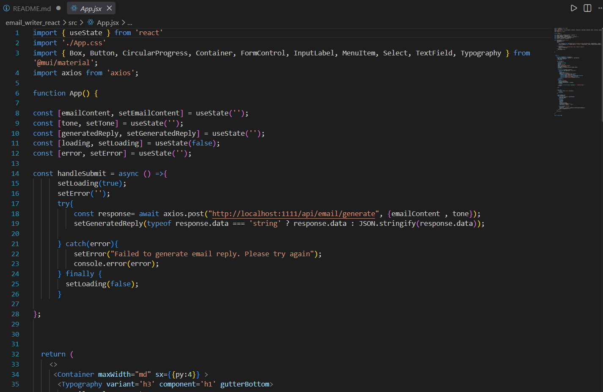
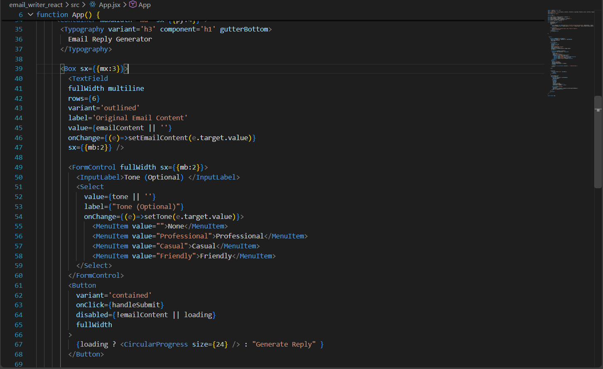
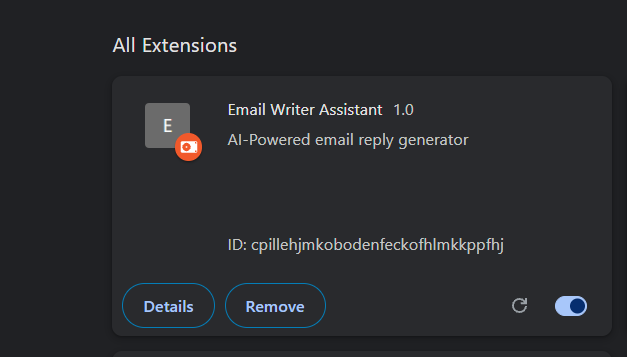

# 🤖 Smart-AI-Based-Email-Assitance.

> An AI-powered full-stack application that generates context-aware email replies using Google Gemini AI, with support for a React web application and direct Gmail integration through a Chrome Extension.

---

## 📌 Brief One Line Summary

**Smart-AI-Based-Email-Assitance is an AI-powered application that generates professional, friendly, and casual email replies using Google Gemini AI.**

---

## 📖 Overview

Smart-AI-Based-Email-Assitance is a full-stack AI application designed to simplify and automate the process of writing email replies.

The application allows users to provide the original email content and optionally select a preferred communication tone. The request is sent to a Spring Boot backend, where a prompt is created and sent to the Google Gemini API. The generated AI response is then returned to the user.

The project consists of three main components:

* 🌐 **React Frontend** – Provides a user-friendly interface for generating email replies.
* ⚙️ **Spring Boot Backend** – Handles API requests, prompt generation, and communication with Google Gemini AI.
* 🧩 **Chrome Extension** – Integrates directly with Gmail and provides an **AI Reply** button inside the Gmail interface.

This project demonstrates how Artificial Intelligence can be integrated into a real-world full-stack application.

---

# ❗ Problem Statement

Writing effective email replies can often be time-consuming.

Users need to consider several factors while writing an email response, including:

* Professional communication
* Appropriate tone
* Grammar and clarity
* Context of the original email
* Formal or informal language
* Response structure

Writing these replies manually can become repetitive and time-consuming.

The **Smart-AI-Based-Email-Assitance.** solves this problem by using Generative AI to automatically generate an email reply based on the original email content and the user's preferred tone.

---

# 🎯 Project Objectives

The main objectives of this project are:

* To automate the process of generating email replies.
* To integrate Generative AI into a full-stack application.
* To allow users to select different communication tones.
* To provide a simple and user-friendly interface.
* To integrate AI functionality directly into Gmail.
* To demonstrate communication between a React frontend and Spring Boot backend.
* To use the Google Gemini API for AI-powered text generation.

---


# 🛠️ Tools and Technologies

## Frontend

| Technology  | Purpose                      |
| ----------- | ---------------------------- |
| React       | Building the user interface  |
| JavaScript  | Application logic            |
| Material UI | User interface components    |
| Axios       | HTTP requests to the backend |

## Backend

| Technology     | Purpose                           |
| -------------- | --------------------------------- |
| Java           | Backend programming language      |
| Spring Boot    | Backend application framework     |
| Spring WebFlux | Reactive web functionality        |
| WebClient      | Communication with the Gemini API |
| Lombok         | Reducing boilerplate code         |
| Maven          | Dependency and project management |

## Artificial Intelligence

| Technology        | Purpose                             |
| ----------------- | ----------------------------------- |
| Google Gemini API | Generating AI-powered email replies |

## Chrome Extension

| Technology           | Purpose                         |
| -------------------- | ------------------------------- |
| Chrome Extension API | Browser extension functionality |
| Manifest V3          | Chrome extension configuration  |
| JavaScript           | Extension logic                 |

## Development Tools

* Visual Studio Code
* Git
* GitHub
* npm
* Maven
* Google Chrome

---

# 🏗️ System Architecture

The project follows a client-server architecture.

```text
                    ┌──────────────────────┐
                    │     React Frontend   │
                    │                      │
                    │  Enter Email Content │
                    │  Select Tone         │
                    │  Generate Reply      │
                    └──────────┬───────────┘
                               │
                               │ HTTP Request
                               ▼
                    ┌──────────────────────┐
                    │  Spring Boot Backend │
                    │                      │
                    │  /api/email/generate │
                    └──────────┬───────────┘
                               │
                               │ Prompt + API Request
                               ▼
                    ┌──────────────────────┐
                    │   Google Gemini AI   │
                    │                      │
                    │ Generate Email Reply │
                    └──────────┬───────────┘
                               │
                               │ Generated Response
                               ▼
                    ┌──────────────────────┐
                    │   User / Gmail UI    │
                    └──────────────────────┘
```

The Chrome Extension also communicates with the same backend API.

```text
Gmail
  │
  ▼
Chrome Extension
  │
  ▼
Spring Boot Backend
  │
  ▼
Google Gemini AI
  │
  ▼
Generated Reply
  │
  ▼
Inserted into Gmail Compose Box
```


# ⚙️ Methods / Application Workflow

The application follows the steps below.

## Step 1: User Provides Email Content

The user enters the original email content into the React application.

The application provides a text area where the user can paste or write the email.

---

## Step 2: User Selects a Tone

The user can optionally select a preferred tone.

Available tones include:

* Professional
* Casual
* Friendly

The user can also leave the tone empty.

---

## Step 3: Frontend Sends API Request

The React frontend sends a POST request to the backend.

### API Endpoint

```http
POST /api/email/generate
```

### Request Body

```json
{
  "emailContent": "Hi, I would like to schedule a meeting next week.",
  "tone": "Professional"
}
```

Axios is used in the React application to send the HTTP request.

---

## Step 4: Backend Receives the Request

The Spring Boot backend receives the request through the controller.

The request contains:

* `emailContent`
* `tone`

The backend endpoint is:

```text
/api/email/generate
```

The controller passes the request to the service layer.

---

## Step 5: Prompt Generation

The backend creates an AI prompt using the email content and selected tone.

The prompt follows this structure:

```text
Generate a professional mail reply for the following email content.

Use a Professional tone.

Original email:

[User Email Content]
```

If a tone is selected, it is included in the prompt.

---

## Step 6: Request Sent to Google Gemini AI

The backend uses Spring's `WebClient` to send the generated prompt to the Google Gemini API.

The API processes the request and generates an appropriate email response.

---

## Step 7: Response Processing

The backend receives the AI-generated response.

The application extracts the generated text from the API response and cleans the output before returning it to the frontend.

---

## Step 8: Generated Reply Displayed

The React application displays the generated email reply.

The user can then:

* Read the generated response.
* Copy the response using the **Copy to Clipboard** button.
* Use the generated reply in their email.
---


# 🖥️ Application Output

The application generates an email reply based on the user's input.

## Example Input

```text
Hi,

I would like to schedule a meeting with you next week to discuss the project.

Please let me know your availability.

Thank you.
```

## Selected Tone

```text
Professional
```

## Generated Output

```text
Hi,

Thank you for reaching out.

I would be happy to schedule a meeting next week to discuss the project. Please let me know your preferred date and time, and I will do my best to accommodate it.

Best regards
```

The actual response may vary depending on the AI model and input content.

---

# 📸 Dashboard / Screenshots






## React Application

```md


```

## Generated Email Reply

```md

```

## Gmail Chrome Extension

```md

```


---


# 🚀 Future Work

The project can be improved with the following features:

* [ ] Add more email tones.
* [ ] Allow users to enter a custom tone.
* [ ] Add multiple AI model support.
* [ ] Add email history.
* [ ] Add user authentication.
* [ ] Save generated replies.
* [ ] Improve Gmail email content detection.
* [ ] Add support for multiple languages.
* [ ] Add dark mode.
* [ ] Add a regenerate reply feature.


---

# 👨‍💻 Author & Contact

**Priyanka Rasal**

### GitHub

https://github.com/Priyanka-rasal2000


### LinkedIn

www.linkedin.com/in/priyankarasal555

### Email

[pjrasal2019@gmail.com](mailto:pjrasal2019@gmail.com)

---

# ⭐ Support

If you like this project, please consider giving it a ⭐ on GitHub.

Your support helps others discover the project and encourages future improvements.

---

<p align="center">

Made with ❤️ using React, Spring Boot, Google Gemini AI, and Chrome Extension APIs.

</p>
